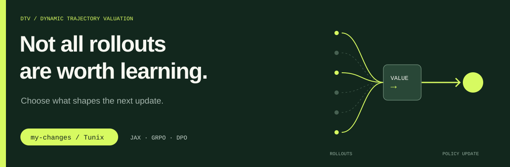

## Not All Rollouts Are Worth Learning
### On Trajectory Valuation for Post-Training Reinforcement Learning

Xuesong Jia<sup>&#42;</sup>, **Ziao Yang**<sup>&#42;</sup>, Zhanhe Huang, and Hongfu Liu  
<sub>*Equal contribution.</sub>

**[PDF](https://arxiv.org/pdf/2609.35072)** · [Paper](https://arxiv.org/abs/2609.35072) · [Tunix documentation](README-tunix.md)

Research code on the **`my-changes`** branch, with gradient-based sample curation for **GRPO** and **DPO**.

## Pick a training path

### GRPO / rollout curation

Start with the [self-influence trainer](tunix/rl/self_inf_trainer.py) and [GRPO launcher](my_example/run_dbc_self_inf_batch.sh). [DeepScaler recipes](examples/deepscaler/README.md) provide another experiment entry point.

### DPO / preference curation

Follow the [DPO recipes](examples/dpo/README.md) for `baseline`, `outlier_l2`, and `self_inf_batch` comparisons. The [trainer implementation](tunix/sft/dpo/dpo_trainer.py) handles curation; the [SFT → DPO guide](examples/ultrafeedback/README.md) connects the stages.

## Check out the research branch

```bash
git clone --branch my-changes --single-branch https://github.com/yangziao56/tunix.git
cd tunix
```

Each recipe contains its environment setup, model configuration, and launch commands.

---

Built on [Google Tunix](https://github.com/google/tunix), a JAX-based library for LLM post-training. The original installation guide, citation, and acknowledgements are preserved in the [Tunix README](README-tunix.md).

<details>
<summary><strong>Citation</strong></summary>

```bibtex
@misc{jia2026tunix,
  title = {Not All Rollouts Are Worth Learning: On Trajectory Valuation for Post-Training Reinforcement Learning},
  author = {Jia, Xuesong and Yang, Ziao and Huang, Zhanhe and Liu, Hongfu},
  year = {2026},
  eprint = {2609.35072},
  archivePrefix = {arXiv},
  url = {https://arxiv.org/abs/2609.35072}
}
```

</details>
